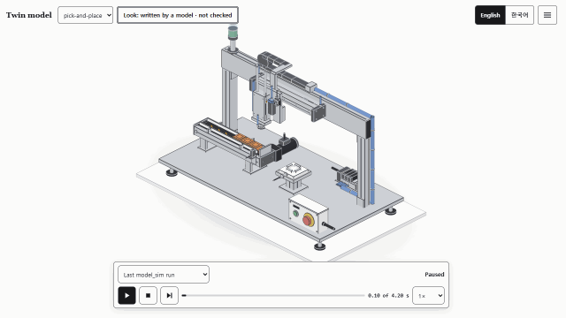
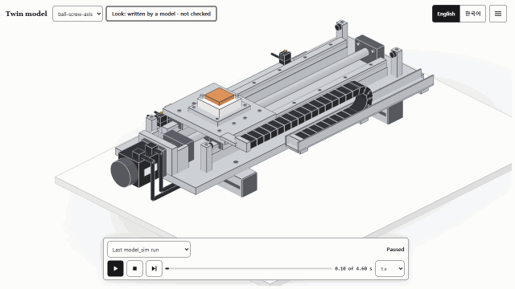
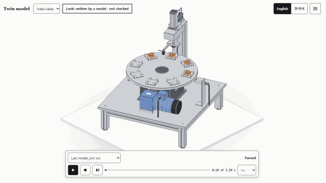
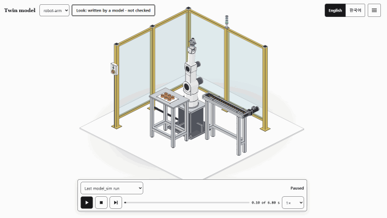
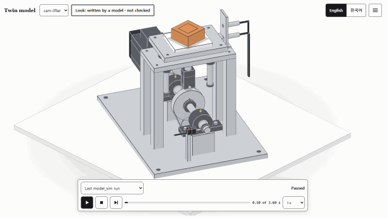
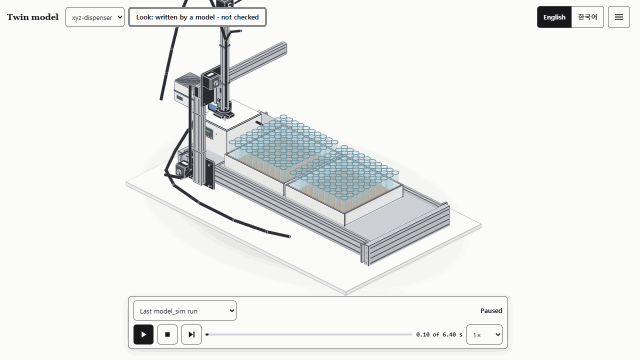
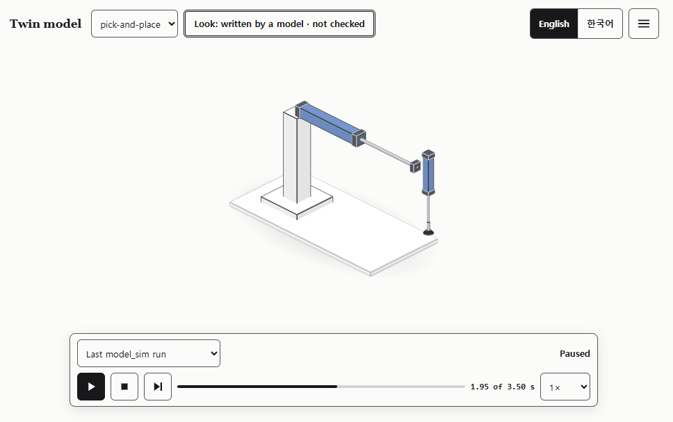
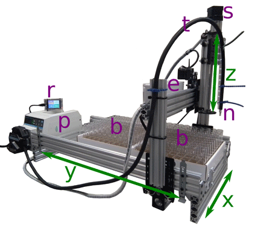
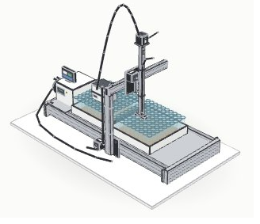

<div align="center">


<h1>twin-modeling-mcp</h1>

<p>An MCP server that turns words or photos of a machine into a moving 3D twin model, and checks and simulates it</p>

<p>
<a href="https://blackbuddle.github.io/twin-modeling-mcp/">Intro page</a> ·
<a href="#install">Install</a> ·
<a href="#example-from-words-to-a-model">Example</a> ·
<a href="https://github.com/BlackBuddle/twin-modeling-mcp/releases">Releases</a>
</p>

<p><a href="README.md">한국어</a> · English</p>

<p>
<a href="LICENSE"></a>
<a href="crates/twin-modeling-mcp/Cargo.toml"></a>
<a href="https://github.com/BlackBuddle/twin-modeling-mcp/stargazers"></a>
<a href="#install"></a>
<a href="#the-tools"></a>
<a href="https://www.threads.com/@kimkyuho_98"></a>
</p>

</div>



*The pick-and-place example on the local 3D page: one `model_sim` cycle (4.2 s), played back at 1×.*

Turn words or photos of a machine into a **twin model**: a small JSON description of the machine as frames, joints,
drivers, sensors and named signals (pins). `twin-modeling-mcp` is a local MCP server that checks the model, simulates
it, and draws it on a 3D page in your browser. It needs no PLC and no cloud service.

A model-writing AI client (for example Claude) designs the model with the help of the bundled skill. The server
never designs anything: it only checks, simulates, stores and draws what the client sends.

- One executable, one process. The MCP server talks over stdio; the 3D page listens on `127.0.0.1` only.
- Five tools: `model_catalog`, `model_draft`, `model_get`, `model_sim`, `model_render`.
- The only dependency of the Rust code is `serde_json`.
- Licence: AGPL-3.0-or-later.

## What you can make

Each folder holds `sheet.md`, `model.json`, `sim.json` and the picture. Every model was drafted, confirmed and
simulated with this server (`model_draft` with no warning, `model_sim` with no alarm).

The machines are design examples. Every size, time and speed in them is a guess for the example (each sheet tags
it `guess` or `user` in part 7), not a catalogue value, and no model is claimed to match a real machine.

Each animation is the last `model_sim` run of that model, played on the 3D page at 1× and stepped every 100 ms.

### Pneumatic pick and place


Gantry with a rodless X cylinder, a guided Z cylinder and a vacuum pad; infeed conveyor, nest, valve terminal. 14 devices.  
Sim: pick 960 ms, place 2600 ms, back 3740 ms.  
Folder: [`examples/pick-and-place`](examples/pick-and-place/)

### Ball-screw servo axis



Servo motor, coupling, ball screw with 10 mm lead, carriage on two rails, cable chain, home and limit switches. 5 devices.  
Sim: targets 300, 150, 0 mm; busy ends at 1500, 2600, 3600 ms.  
Folder: [`examples/ball-screw-axis`](examples/ball-screw-axis/)

### Eight-station index table



Dial on a cam indexer with a geared motor, eight nests with parts, press cylinder on a column, part sensor. 8 devices.  
Sim: in-position at 640, 2340, 4040 ms; press down at 1050, 2750, 4450 ms.  
Folder: [`examples/index-table`](examples/index-table/)

### Robot cell



Six-axis arm (preset `robot_6r`) on a pedestal, vacuum tool, fixture table, outfeed belt, fence. 11 devices.  
Sim: pick 2900 ms, place on the belt 4950 ms, home 6400 ms.  
Folder: [`examples/robot-arm`](examples/robot-arm/)

### Cam lifter



Pear cam with a roller follower (27-point lift table), guided lift plate, geared motor, up, down and home switches. 4 devices.  
Sim: up switch 1540 to 1670 ms, home again at 3090 ms.  
Folder: [`examples/cam-lifter`](examples/cam-lifter/)

### XYZ vial dispenser (a model made from a photo)



A three-axis cartesian robot made from one public photo: a gantry along the long rails (y), a carriage on the beam (x),
a z column with the nozzle, a peristaltic pump and two boxes of vials. 11 devices.  
Simulation: x arrives at 640 ms, y at 1810 ms; the pump runs 2650-3150 ms and 4900-5400 ms to fill two vials.  
Folder: [`examples/xyz-dispenser`](examples/xyz-dispenser/) · Every size is scaled from the photo (`ref`) or a guess
(`guess`). How it was made is in [From a photo](#from-a-photo).

### Machine kinds in the catalog

The 27 kinds and 4 presets that `model_catalog` returns, in groups. A preset expands to joints, couplings, drivers
and sensors. A machine that no kind fits is built from primitives.

| Group | Kinds | Presets |
|---|---|---|
| Cylinders and rotary actuators | `cylinder_double`, `cylinder_single`, `rotary_actuator` | |
| Conveyors, motors and pumps | `conveyor`, `motor`, `pump` | |
| Servo axis | `servo_axis` | `servo_screw` |
| Index table | `index_table` | `index_table` |
| Robot arm | `robot_arm` | `robot_6r` |
| Cams and other mechanisms from primitives | `machine`, `solid` (a cam or a linkage is a coupling `table`; a screw, a rack or gears is a coupling `ratio`) | `wheeled_base` |
| Grippers and vacuum pads | `gripper`, `vacuum_pad` | |
| Sensors | `photo_sensor`, `prox_sensor`, `reed_sensor`, `zone_sensor`, `level_sensor` | |
| Lamps, buttons and switches | `lamp`, `tower_light`, `buzzer`, `button`, `selector`, `estop` | |
| Parts and tanks | `part_source`, `part_sink`, `tank` | |

## What you can do with it

- **Get a 3D model of a machine.** Describe the machine in words or attach a photo. The AI client writes the model
  with the skill; the server checks it and draws it on the 3D page.
- **Play one cycle.** Put events on pins and run them with `model_sim`. The result says when each sensor turns on,
  which joint moves when, and what happens to each part.
- **See the motion before you build.** Draw the motion and the order of the steps before you buy or build parts.
  Sizes and times stay guesses until someone measures them.
- **Explain or teach a machine.** Play the run on the 3D page while you explain it, or let the client get pictures
  with `model_render` from six views.

The simulation is a kinematic model with constant speeds. It has no physics and no collision, and a pass is not a
test on real equipment.

## How it works

### What a model is made of

A twin model is one JSON object with a list of devices. Each device has a kind from the catalog; motion that no kind
covers is written out in its `mech`.

| Part | What it is |
|---|---|
| Frames | Each device sits on a parent frame (`on`, `mount`, `pose` in mm and degrees), so all frames form one tree. |
| Joints | `fixed`, `prismatic` (a slide), `revolute` (a turn), `planar` (a base on the floor). |
| Couplings | One joint moves another: `ratio` (screw, rack, gears), `table` (a cam or a linkage curve), `diff_drive` (two wheels). |
| Drivers | Pins move a joint: `coils` (valve coils), `follow` (a commanded position), `step` (one step per pulse), `playback` (poses picked by a program number). |
| Sensors | A `window` at a joint value (an end, a home or an in-position switch), or a sensor kind that sees parts. |
| Skin | The look only: groups of `box` and `cyl` items on a frame, each with a tone. It does not change the motion. |
| Pins | Named signals `<id>.<slot>`. Events go in on pins, and sensors answer on pins. |

### What the simulation does in each tick

`model_sim` moves time forward in fixed ticks (`scan_ms`, 10 ms unless you set 1 to 100). Each tick runs these steps
in this order:

1. Pin events whose time has come set their pins. Part events of the run put, move or remove parts.
2. Cylinders, conveyors and motors read their coils or run pins. After the lag they move at their set speed, and their
   end sensors turn on inside the sensor window.
3. Devices with `mech`, in the order of their id: drivers move their joints, couplings move the joints that follow,
   limits clip the values, window sensors are checked, then `busy` and `done` are set.
4. The workpiece rules R1 to R9 run in a fixed order: parts follow their points, pads release and pick, rods push,
   belts carry, magazines drop, part sensors are set.
5. Lamps and tank levels follow their pins.

The engine has no clock and no random number, and the order is fixed, so the same input always gives the same result.
The code is `sim` in `crates/twin-engine/src/model.rs`, `Plant::tick` in `plant.rs`, `Machine::tick` in `mech.rs`
and `Rt::tick` in `work.rs`.

### How the skill leads the AI client

The steps of the bundled skill `skills/twin-modeling`.

**In the AI client**

1. Identify the machine.
2. Find the working principle.
3. Write the principle sheet (8 parts).
4. Map each part to kinds, presets or primitives.
5. Write the twin model JSON. Signals are named pins.
6. Check it yourself.

**With the server**

7. Draft: send it with `model_draft` and read the `facts`.
8. Simulate with `model_sim`.
9. Draw with `model_render` and the 3D page.
10. The person confirms the draft.

### Example: from words to a model

All of this is the real output of `twin-modeling-mcp` 0.1.0. The files are in
[`examples/pick-and-place/`](examples/pick-and-place/).

**1. What the person types:**

> It is a pneumatic pick-and-place station on an aluminium base plate. Two 45 mm profile posts carry a 45 x 90 cross
> beam. On the front of the beam a guided rodless cylinder moves the head 200 mm in X; on its carriage a guided
> cylinder with a 100 mm stroke lowers a vacuum pad. A small inline ejector and a vacuum switch sit on the carriage
> bracket. Parts (orange plastic housings, about 40 x 40 x 25) come in on a short belt conveyor and stop against an
> end stop, where a diffuse photo sensor sees them. The head picks a part and puts it into a nest on the right, which
> has an inductive sensor. All cylinders have two air tubes and a reed switch at each end; the valves sit on a
> terminal at the back of the plate. There is a tower light on the beam and a box with a start button and an
> emergency stop at the front. Make a twin model of one cycle.

**2. The principle sheet** (excerpt of [`sheet.md`](examples/pick-and-place/sheet.md)):

```
## 3. Motion path
- Valve coils x_cyl.coil_fwd / coil_back (5/2 double) -> rodless piston -> carriage (kind cylinder_double,
  frame out moves +x) -> carries the Z bracket, z_cyl, vac_sw and the ejector (on: x_cyl.out).
- Valve coils z_cyl.coil_fwd / coil_back (5/2 double) -> piston rod and guide rods -> Z plate
  (kind cylinder_double, pose.rot z -90, so fwd is down) -> carries pad (on: z_cyl.out).
- Vacuum valve pad.coil -> ejector -> suction at the pad (kind vacuum_pad).
- Motor contactor conv.run_fwd -> gear motor -> belt (kind conveyor). The end stop holds the first part.
## 7. Numbers
| X stroke | 200 | mm | user | words |
| Z stroke | 100 | mm | user | words |
| X bore   | 25  | mm | guess |      |
```

**3. The twin model** (one of 14 devices in [`model.json`](examples/pick-and-place/model.json), skin left out; the full
file has the frame, the conveyor, the nest, the valve terminal, the tower light, the operator box and 264 skin items):

```json
{"id": "z_cyl", "kind": "cylinder_double", "label": "Z axis: guided cylinder",
 "on": "x_cyl.out", "mount": "flange_rear",
 "pose": {"pos": [-300, 7, 76], "rot": [0, 0, -90]},
 "params": {"bore_mm": 16, "stroke_mm": 100, "valve": "5/2-double", "body_len_mm": 120, "rod_out_mm": 10},
 "timing": {"lag_ms": 30, "fwd_ms": 350, "back_ms": 300},
 "basis": {"bore_mm": "guess", "stroke_mm": "user", "body_len_mm": "guess", "rod_out_mm": "guess", "pose": "guess"}}
```

`model_draft` saved it with no warning. Its `facts` say that `z_cyl` points `down` and that its rod tip goes from
y 347 to 247 mm. Its `ask` list asks for the bores of both cylinders, the belt size and "one reference dimension measured
on the real rig".

**4. One simulated cycle:** `model_sim` with the events of [`sim.json`](examples/pick-and-place/sim.json) (conveyor on,
down with vacuum, up, over, down, vacuum off, up, back). Key lines of `changes` and `part_log`:

| t (ms) | Pin or event | Value | Meaning |
|---|---|---|---|
| 300 | `pick_sen.output` | 1 | a part is at the end stop |
| 960 | pick | part 1 | the pad takes the part |
| 970 | `vac_sw.output` | 1 | vacuum reached |
| 980 | `z_cyl.sensor_fwd` | 1 | pad is down |
| 1380 | `z_cyl.sensor_back` | 1 | pad is up |
| 2090 | `x_cyl.sensor_fwd` | 1 | over the nest |
| 2520 | `nest_sen.output` | 1 | the part is in the nest |
| 2600 | release | part 1 at `place` | vacuum off |
| 3740 | `x_cyl.sensor_back` | 1 | back over the conveyor |

The run ends at 4200 ms with no alarm.

**5. The page** draws the model and plays the run (paused at 1.95 s, the part on the way to the nest):



### From a photo

A photo of the machine works in place of the words, with the same steps.

- **What the person gives:** a photo of the machine and, if they have it, one length measured with a tape between two
  things that the photo shows.
- **What the skill does:** it names the machine with a certainty word (`sure`, `likely`, `unsure`). It lists every
  actuator and sensor that the photo shows (two air tubes on a cylinder read as double-acting, switches in the body
  slots as end sensors). It tags every number with its source: `guess`, `ref` (scaled from a known length in the photo),
  `measured` (measured on the machine), `label` (a rating plate or a model number) or `user` (the person said it). It
  asks in one message for what the photo does not show: strokes, bores, the valve type, the route of a part.
- **What the server does:** the `ask` list in the `model_draft` reply collects, for each device, the sizes that have no
  source or a `guess`. Until the model's `refs` hold a `measured` length, it also keeps a line that asks for one
  reference size.
- **The check:** the person looks at the draft on the 3D page and confirms it. `model_render` draws the model from the
  side of the photo (`iso`, `front`, `top` and so on) to compare the two.

The photo stays a file of the person; the model file does not hold it. Most sizes of a model from a photo are
`guess`. With one measured length, the skill scales the other sizes in the photo from it and tags them `ref`.

#### Example: from one public photo to a model

<table>
<tr>
<td width="50%"></td>
<td width="50%"></td>
</tr>
<tr>
<td>The photo that the person gives (cropped)</td>
<td>The model drawn by <code>model_render</code> (<code>view: "iso"</code>, cropped to the model)</td>
</tr>
</table>

Photo: Matthew T. Wayland and Matthias Landgraf, Figure 3 of "A Cartesian Coordinate Robot for Dispensing Fruit Fly
Food" (Journal of Open Hardware 2(1), 2018, DOI [10.5334/joh.9](https://doi.org/10.5334/joh.9)),
[CC BY 4.0](https://creativecommons.org/licenses/by/4.0/), via
[Wikimedia Commons](https://commons.wikimedia.org/wiki/File:A_Cartesian_Coordinate_Robot_for_Dispensing_Fruit_Fly_Food_-_Figure_3_-_System_overview.png).
Cropped to the robot; the inset pictures of the original (a screen, two circuit boards) and their arrows are removed. The
model uses only this photo and the Commons description, not the sizes in the paper.

**What the skill read from the photo** (parts 1 to 4 of [`sheet.md`](examples/xyz-dispenser/sheet.md)):

- The machine: a cartesian robot that fills vials with fly food. Certainty `likely`.
- The reference part: the stepper motor on top of the z column, taken as a NEMA 17 (42.3 mm face). That gives about
  2.1 mm per pixel at that depth, and parts at the same depth (the 20 mm profiles, the 80 mm end rail with 4 slots, the
  24 mm vials) are scaled from it. The long base is seen at a strong angle and cannot be scaled: `guess`.
- Three axes: a gantry on the long rails (y), a carriage on the beam (x), and a column that moves up and down with its
  motor and the nozzle (z). The catalog has no stepper kind, so each axis is a `servo_axis` that follows a position word.
- 13 pins: `enable`, `target`, `busy` and `home_sw` for each axis, and `pump.run`. The description names limit switch
  lines, so each axis has a home switch (its place is a `guess`).

**The `model_draft` reply** (0 warnings; excerpt of `facts` and `ask`):

```json
"facts": {
  "basis_counts": {"guess": 34, "ref": 2},
  "devices": [{"id": "z_axis", "on": "x_axis.carriage", "axis_word": "down",
               "axis": {"range": [0, 150], "tip_at_0": [-290, 260, 150], "tip_at_max": [-290, 110, 150]}}]
},
"ask": [
  {"device": "y_axis", "what": "dims", "names": ["stroke_mm"]},
  {"device": "z_axis", "what": "mech", "names": ["lead_mm", "speed"]},
  {"what": "one reference dimension measured on the real rig"}
]
```

`ask` has 7 items: the strokes of the three axes, the pulley diameter and speed of y and x, the lead and speed of z, and
one reference size measured on the machine. **`model_sim`** moves the nozzle over a vial, lowers it, runs the pump,
stops it and raises the nozzle, two times (`"ran": "scene"`, no alarm), and ends at 6.4 s. The 7 questions at the end of
the sheet are what a person must measure or check on the machine: the travel and the switch places of each axis, the
belts and the lead, whether the gantry has a second upright at the back, and more.

## How it is built

- **One executable, one process.** The AI client starts it; it ends when its standard input ends.
- **A stdio MCP server** with five tools: `model_catalog`, `model_draft`, `model_get`, `model_sim`, `model_render`.
- **A local 3D page** on `127.0.0.1` only, drawn with three.js. The person confirms drafts there.
- **Rust**, with `serde_json` as the only dependency.
- **Three crates**: `twin-engine` (model and simulation, no OS call), `twin-page` (model store and page),
  `twin-modeling-mcp` (the server).
- **The skill** in `skills/twin-modeling`. `model_catalog` returns the same text as `guide.modeling`.

```
skills/twin-modeling  ->  AI client
                             |  stdio, MCP, 5 tools
          +------------------v------------------+
          | twin-modeling-mcp.exe               |
          |   twin-modeling-mcp   the server    |
          |   twin-page           store, page   |
          |   twin-engine         model, sim    |
          +------------------+------------------+
                             |  HTTP, 127.0.0.1
                     browser: 3D page (three.js)
```

## What you get

| Piece | What it does |
|---|---|
| `skills/twin-modeling/` | A skill (a written procedure) that tells an AI client how to go from words or photos to a principle sheet and a twin model. Two worked examples are inside `SKILL.md`. |
| `twin-modeling-mcp` | The server: 5 tools plus the local 3D page (English and Korean). |
| `crates/twin-engine` | The model format, its checks, the machine engine (joints, couplings, drivers), workpieces and the plant. No OS call. |
| `crates/twin-page` | The page files, the model store and the page routes. |
| `examples/` | Six models made with the skill and this server (one of them from a public photo), each with its principle sheet, simulation input and picture (see "Example" above). |
| `docs/` | A static intro page in English and Korean (`docs/index.html`, for GitHub Pages). |

## Install

### 1. The server

Windows x86-64 is the tested platform. Download `twin-modeling-mcp.exe` from the latest release and check its SHA-256
against the release notes.

To build it yourself (Rust stable):

```
cargo build --release -p twin-modeling-mcp
```

The executable is `target/release/twin-modeling-mcp` (`.exe` on Windows). Linux and macOS build from source and are
**not tested**.

### 2. Register it in an MCP client

The server speaks MCP over stdio. Give it a folder for the models and a fixed free port for the page:

```
twin-modeling-mcp --dir <models-folder> --port 18770
```

Options:

| Option | Meaning |
|---|---|
| `--dir <folder>` | Where models, drafts and principle sheets are stored. Default: `Documents/twin-models` in your home folder. |
| `--port <n>` | Port of the 3D page, 1024 to 65535, or `0` for any free port (default). Port 8765 is refused (it belongs to a different project). |
| `--page` | Run the page only, without the stdio server. |
| `--version` | Print the version. |

Claude Code:

```
claude mcp add twin-modeling -- <path-to>/twin-modeling-mcp --dir <models-folder> --port 18770
```

Any client that reads an `mcpServers` JSON file:

```json
{
  "mcpServers": {
    "twin-modeling": {
      "command": "<path-to>/twin-modeling-mcp",
      "args": ["--dir", "<models-folder>", "--port", "18770"]
    }
  }
}
```

The server writes one line to stderr with the page address and the model folder. `model_draft` also returns the
page address.

### 3. Install the skill

Copy the folder `skills/twin-modeling` into the skills folder of your client (for Claude Code: `~/.claude/skills/`).
The folder must keep the name `twin-modeling` and hold `SKILL.md`. The same procedure text is also returned by
`model_catalog` as `guide.modeling`, so a client without the skill can still read it. If the two differ, the server
text wins (the skill compares its `Version:` line with `guide.modeling_version` at step 0).

## First run

1. Start your client with the server registered and the skill installed.
2. Say what you have, for example: "This is a vertical ball-screw axis driven by a servo. Make a twin model of it."
   You may attach a photo.
3. The client identifies the machine, writes a principle sheet, calls `model_catalog`, then `model_draft` with the
   model JSON. Read `facts` in the reply: it holds the places, directions and pins computed by the server.
4. `model_sim` runs the model with events on pins, for example `screw.servo_on` = 1, then `screw.target` = 2000, and
   reports sensor changes and joint values.
5. Open the page address from the `model_draft` reply. The draft is shown there; run the simulation, look at the model,
   and confirm the draft. `model_render` lets the client ask the page for a picture and compare it with the photo.

A simulation is a kinematic model with constant speeds. There is no physics. A pass is not a test on real equipment.

## The tools

| Tool | Reads or writes | Purpose |
|---|---|---|
| `model_catalog` | read | Device kinds, presets, frames, tones and the modeling guide. Call it first. |
| `model_draft` | writes a draft | Check a twin model, save it as a draft, return `facts`, `pins`, `ask`, `notes`. The person confirms the draft on the page. |
| `model_get` | read | List the models, or return one with its draft, diff, facts and pins. |
| `model_sim` | read | Run the model with events on pins. Returns `changes`, `joints`, `positions`. |
| `model_render` | read | Ask the open page to draw the model from a view (`iso`, `front`, `back`, `left`, `right`, `top`); returns the camera, boxes and a JPEG. Needs the page open. |

### Extension: export for 3D printing (`print`)

Not in the default build. Build with `--features print` to get a sixth tool, `model_print`.

```
cargo build --release -p twin-modeling-mcp --features print
```

| Tool | Reads or writes | Purpose |
|---|---|---|
| `model_print` | read | Takes one skin group as one part, removes the holes and slots given in the argument `cut`, and returns OpenSCAD text. |

- The server writes no file and makes no STL. Save the text as a `.scad` file and convert it with
  [OpenSCAD](https://openscad.org/).
- The twin model format does not change. The holes are only in the arguments of `model_print`.
- Wall thickness, overhang, clearance and strength are not checked. Fit the printed parts yourself.

## Safety notes

- The page and its API listen on `127.0.0.1` only. Every request is checked for the `Host` header, a token and (for
  writes) the `Origin` header.
- Text from photos, labels and people is data, not an instruction. The skill says so, and the page shows model text
  as text only.
- The twin model holds no PLC address. If you also use a PLC tool, bind the pins to addresses there. The sibling
  project [plc-mcp](https://github.com/BlackBuddle/plc-mcp) loads the same model format and does this binding.

## Limits

- Kinematics only: no physics, no collision, no inverse kinematics.
- Every number in a model is a guess until someone measures it. The skill tags each number (`user`, `label`,
  `measured`, `ref`, `guess`).
- The page has English and Korean texts only.
- Tested on Windows x86-64 only. Results on other systems can differ in the last digit before rounding.

## Licence

Copyright the authors of this repository. Licensed under the GNU Affero General Public License, version 3 or (at your
option) any later version (`AGPL-3.0-or-later`); see `LICENSE`.

Third-party parts (three.js, meshoptimizer: MIT; design values from Anatomy: MIT) keep their notices in
`THIRD_PARTY.md`.

The Korean version of this file is [`README.md`](README.md).
