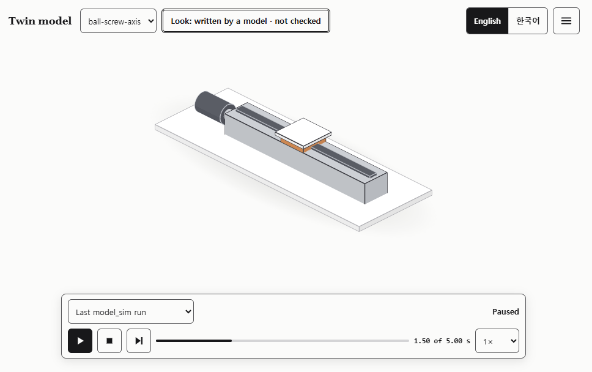
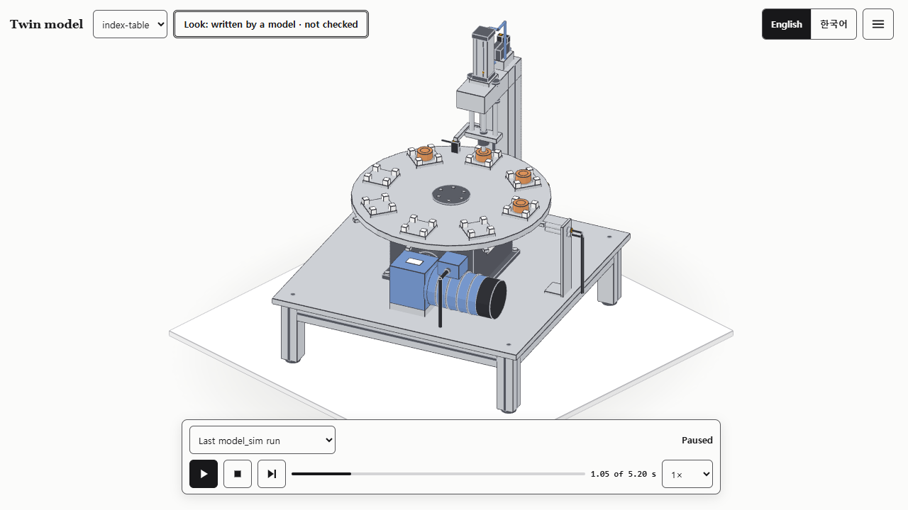
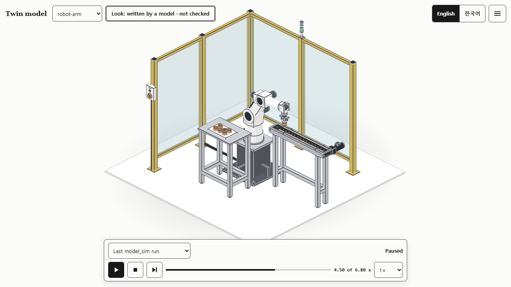
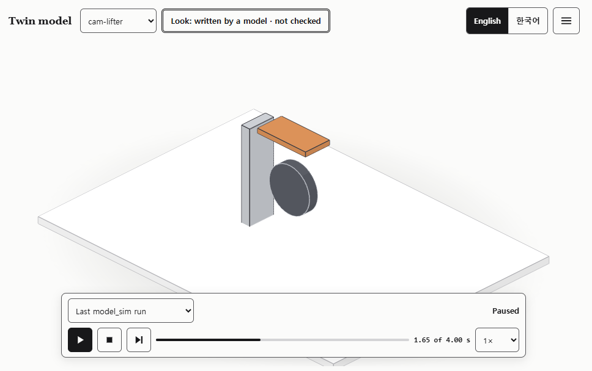

# twin-modeling-mcp

기계에 대한 설명이나 사진을 **트윈 모델**로 바꿔 주는 도구입니다. 트윈 모델은 기계를 프레임, 관절, 구동기, 센서,
이름 붙은 신호(핀)로 적은 작은 JSON입니다. `twin-modeling-mcp`는 이 모델을 검사하고 시뮬레이션해서 브라우저의
3D 화면에 그려 주는 로컬 MCP 서버입니다. PLC도 클라우드 서비스도 필요 없습니다.

모델은 Claude 같은 AI 클라이언트가 함께 들어 있는 스킬을 보고 설계합니다. 서버는 설계를 하지 않습니다. 클라이언트가
보낸 모델을 검사하고 시뮬레이션하고 저장하고 그릴 뿐입니다.

- 실행 파일 하나, 프로세스 하나입니다. MCP 서버는 표준 입출력으로 말하고, 3D 화면은 `127.0.0.1`에서만 듣습니다.
- 도구는 다섯 개입니다: `model_catalog`, `model_draft`, `model_get`, `model_sim`, `model_render`.
- Rust 코드가 쓰는 외부 크레이트는 `serde_json` 하나입니다.
- 라이선스는 AGPL-3.0-or-later입니다.

## 들어 있는 것

| 구성 | 하는 일 |
|---|---|
| `skills/twin-modeling/` | 설명이나 사진에서 원리 시트와 트윈 모델까지 가는 순서를 AI 클라이언트에게 알려 주는 스킬(작성된 절차)입니다. 예시 두 개가 `SKILL.md` 안에 있습니다. |
| `twin-modeling-mcp` | 서버입니다. 도구 5개와 로컬 3D 화면(영어·한국어)을 제공합니다. |
| `crates/twin-engine` | 모델 형식과 검사, 기계 엔진(관절, 연동, 구동기), 공작물, 플랜트가 있습니다. OS 호출은 없습니다. |
| `crates/twin-page` | 화면 파일, 모델 저장소, 화면 경로가 있습니다. |
| `examples/` | 스킬과 이 서버로 만든 모델 5개입니다. 모델마다 원리 시트, 시뮬레이션 입력, 그림이 있습니다(아래 "예시" 참고). |
| `docs/` | 영어·한국어 정적 소개 페이지(`docs/index.html`, GitHub Pages용)입니다. |

## 설치

### 1. 서버

시험해 본 환경은 Windows x86-64뿐입니다. 최신 릴리스에서 `twin-modeling-mcp.exe`를 받고, 릴리스 노트의 SHA-256과
맞는지 확인하세요.

직접 빌드하려면(Rust stable):

```
cargo build --release -p twin-modeling-mcp
```

실행 파일은 `target/release/twin-modeling-mcp`입니다(Windows는 `.exe`). Linux와 macOS는 소스에서 빌드하는데,
**시험하지 않았습니다**.

### 2. MCP 클라이언트에 등록

서버는 표준 입출력으로 MCP를 말합니다. 모델을 저장할 폴더와 화면용으로 비어 있는 고정 포트를 주세요.

```
twin-modeling-mcp --dir <모델-폴더> --port 18770
```

옵션:

| 옵션 | 뜻 |
|---|---|
| `--dir <폴더>` | 모델, 초안, 원리 시트를 저장할 곳입니다. 기본값은 홈 폴더의 `Documents/twin-models`입니다. |
| `--port <n>` | 3D 화면 포트입니다. 1024~65535이거나, 빈 포트를 알아서 고르는 `0`(기본값)입니다. 8765는 다른 프로젝트가 쓰는 포트라 거절합니다. |
| `--page` | 표준 입출력 서버 없이 화면만 띄웁니다. |
| `--version` | 버전을 출력합니다. |

Claude Code에서:

```
claude mcp add twin-modeling -- <실행파일-경로>/twin-modeling-mcp --dir <모델-폴더> --port 18770
```

`mcpServers` JSON 파일을 읽는 클라이언트에서:

```json
{
  "mcpServers": {
    "twin-modeling": {
      "command": "<실행파일-경로>/twin-modeling-mcp",
      "args": ["--dir", "<모델-폴더>", "--port", "18770"]
    }
  }
}
```

서버는 시작할 때 화면 주소와 모델 폴더를 stderr에 한 줄로 적습니다. `model_draft`의 응답에도 화면 주소가 들어
있습니다.

### 3. 스킬 설치

`skills/twin-modeling` 폴더를 클라이언트의 스킬 폴더에 복사하세요(Claude Code는 `~/.claude/skills/`).
폴더 이름은 `twin-modeling`이어야 하고 안에 `SKILL.md`가 있어야 합니다. 같은 절차 글을 `model_catalog`가
`guide.modeling`으로도 돌려주므로, 스킬이 없는 클라이언트도 읽을 수 있습니다. 두 글이 다르면 서버 쪽 글이
맞습니다(스킬은 0단계에서 자기 `Version:` 줄을 `guide.modeling_version`과 비교합니다).

## 처음 써 보기

1. 서버를 등록하고 스킬을 설치한 클라이언트를 엽니다.
2. 가진 것을 말합니다. 예: "서보로 도는 수직 볼나사 축이야. 트윈 모델로 만들어 줘." 사진을 붙여도 됩니다.
3. 클라이언트가 기계를 알아보고 원리 시트를 쓴 뒤 `model_catalog`, `model_draft` 순서로 모델 JSON을 보냅니다.
   응답의 `facts`를 보세요. 서버가 계산한 위치, 방향, 핀이 들어 있습니다.
4. `model_sim`은 핀에 이벤트를 넣어 모델을 돌립니다. 예를 들어 `screw.servo_on`을 1로, 이어서 `screw.target`을
   2000으로 두면 센서가 바뀌는 때와 관절 값이 나옵니다.
5. `model_draft` 응답의 화면 주소를 엽니다. 초안이 거기에 나옵니다. 시뮬레이션을 돌려 보고 모델을 살펴본 뒤
   초안을 확정하세요. `model_render`를 쓰면 클라이언트가 화면에 그림을 요청해서 사진과 견줄 수 있습니다.

시뮬레이션은 일정한 속도로 움직이는 운동학 모델입니다. 물리 계산은 없고 시뮬레이션을 통과했다고 실제 장비에서
시험한 것은 아닙니다.

## 예시: 말에서 모델까지

아래 내용은 모두 `twin-modeling-mcp` 0.1.0이 실제로 낸 결과입니다. 파일은
[`examples/pick-and-place/`](examples/pick-and-place/)에 있습니다.

**1. 사람이 쓴 말** (모델과 시트는 영어로 썼습니다):

> A pick-and-place unit: a horizontal air cylinder with 200 mm stroke carries a vertical air cylinder with 100 mm
> stroke. A suction cup sits at the end of the vertical rod. Both cylinders have two air tubes and a switch at each
> end. Make a twin model.

(가로 공압 실린더(행정 200 mm)가 세로 공압 실린더(행정 100 mm)를 싣고 세로 로드 끝에 흡착 패드가 달린 픽앤플레이스
장치입니다. 두 실린더 모두 에어 튜브가 두 개이고 양 끝에 스위치가 있습니다.)

**2. 원리 시트** ([`sheet.md`](examples/pick-and-place/sheet.md) 일부):

```
3. Motion path:
   - Valve coils x_cyl.coil_fwd / coil_back -> x_cyl rod (kind cylinder_double, 5/2 double valve) -> carries z_cyl (on: x_cyl.out).
   - Valve coils z_cyl.coil_fwd / coil_back -> z_cyl rod, pointing down (pose.rot z -90) -> carries pad (on: z_cyl.out).
   - Vacuum valve pad.coil -> suction at the cup (kind vacuum_pad).
7. Numbers: stroke of x_cyl 200 mm (user), stroke of z_cyl 100 mm (user), bores and times (guess).
```

**3. 트윈 모델** ([`model.json`](examples/pick-and-place/model.json) 일부. 전체 파일에는 받침대, 흡착 패드, 외형도
들어 있습니다):

```json
{"id": "z_cyl", "kind": "cylinder_double", "on": "x_cyl.out", "mount": "surface",
 "pose": {"pos": [40, 0, 0], "rot": [0, 0, -90]},
 "params": {"bore_mm": 16, "stroke_mm": 100, "valve": "5/2-double"},
 "timing": {"lag_ms": 30, "fwd_ms": 300, "back_ms": 280},
 "basis": {"bore_mm": "guess", "stroke_mm": "user", "pose": "guess"}}
```

`model_draft`는 경고 없이 저장했으며 응답의 `facts`에 따르면 `z_cyl`은 아래(`down`)를 향하고, 로드 끝은 y 241.5 mm에서
141.5 mm까지 움직입니다.

**4. 한 사이클 시뮬레이션:** [`sim.json`](examples/pick-and-place/sim.json)의 이벤트(내림, 흡착, 올림, 이동, 내림, 흡착 끔,
올림, 복귀)로 `model_sim`을 돌린 결과입니다. `changes`의 주요 줄:

| t (ms) | 핀 | 값 | 뜻 |
|---|---|---|---|
| 330 | `z_cyl.sensor_fwd` | 1 | 패드가 내려감 |
| 500 | `pad.coil` | 1 | 흡착 켬 |
| 1010 | `z_cyl.sensor_back` | 1 | 패드가 올라옴 |
| 1630 | `x_cyl.sensor_fwd` | 1 | 놓을 자리 위에 옴 |
| 2030 | `z_cyl.sensor_fwd` | 1 | 다시 내려감 |
| 3180 | `x_cyl.sensor_back` | 1 | 처음 자리로 돌아옴 |

**5. 화면**에서 모델을 그리고 실행을 재생합니다(1.95 s에서 멈춘 모습):


### 갤러리

폴더마다 `sheet.md`, `model.json`, `sim.json`, 그림이 있고 모든 모델은 이 서버로 초안을 만들고 확정하고
시뮬레이션했습니다. 수치는 추정값입니다(각 시트의 7번 참고).

| 모델 | 보여 주는 것 | 그림 |
|---|---|---|
| [`pick-and-place`](examples/pick-and-place/) | 한 실린더가 다른 실린더를 싣는 복동 실린더 두 개와 흡착 패드. |  |
| [`ball-screw-axis`](examples/ball-screw-axis/) | 프리셋 `servo_screw`: 캐리지가 목표 워드를 따라가고 모터는 1 mm마다 22.5° 돕니다. 2100 ms에 목표 200 mm 도달. |  |
| [`index-table`](examples/index-table/) | 프리셋 `index_table`, 8스테이션: 펄스 하나에 600 ms 동안 한 칸 돕니다. |  |
| [`robot-arm`](examples/robot-arm/) | 프리셋 `robot_6r`, 프로그램 번호로 고르는 티칭 자세 세 개. `done`이 1300, 3100, 4900 ms에 켜짐. |  |
| [`cam-lifter`](examples/cam-lifter/) | 기본 요소만 씀: 도는 축, 캠 표, 승강 관절(스킬의 예시 2). `up_sw`가 1580 ms부터 2230 ms까지 켜짐. |  |

## 도구

| 도구 | 읽기·쓰기 | 용도 |
|---|---|---|
| `model_catalog` | 읽기 | 장치 종류, 프리셋, 프레임, 색조, 모델링 안내를 돌려줍니다. 가장 먼저 부르세요. |
| `model_draft` | 초안 저장 | 트윈 모델을 검사해 초안으로 저장하고 `facts`, `pins`, `ask`, `notes`를 돌려줍니다. 초안은 사람이 화면에서 확정합니다. |
| `model_get` | 읽기 | 모델 목록, 또는 한 모델의 초안·차이·facts·핀을 돌려줍니다. |
| `model_sim` | 읽기 | 핀에 이벤트를 넣어 모델을 돌립니다. `changes`, `joints`, `positions`를 돌려줍니다. |
| `model_render` | 읽기 | 열려 있는 화면에 시점(`iso`, `front`, `back`, `left`, `right`, `top`)을 주고 그리게 해서 카메라, 박스, JPEG를 돌려줍니다. 화면이 열려 있어야 합니다. |

## 안전

- 화면과 API는 `127.0.0.1`에서만 듣습니다. 요청마다 `Host` 헤더와 토큰을 검사하고, 쓰기 요청은 `Origin` 헤더도
  봅니다.
- 사진, 라벨, 사람이 준 글은 데이터이지 지시가 아닙니다. 스킬이 그렇게 정해 두었고 화면도 모델의 글을 글자로만
  보여 줍니다.
- 트윈 모델에는 PLC 주소가 없습니다. PLC 도구와 함께 쓸 때는 그쪽에서 핀에 주소를 묶습니다. 자매 프로젝트
  [plc-mcp](https://github.com/BlackBuddle/plc-mcp)가 같은 모델 형식을 읽어 이 일을 합니다.

## 한계

- 운동학만 다룹니다. 물리, 충돌, 역운동학은 없습니다.
- 모델의 숫자는 누가 재기 전까지 추정값입니다. 스킬은 숫자마다 출처 태그(`user`, `label`, `measured`, `ref`,
  `guess`)를 붙입니다.
- 화면 글은 영어와 한국어만 있습니다.
- Windows x86-64에서만 시험했습니다. 다른 시스템에서는 반올림 전 마지막 자리가 다를 수 있습니다.

## 라이선스

GNU Affero General Public License 3판 또는 그 이후 판(`AGPL-3.0-or-later`)을 따릅니다. 전문은 `LICENSE`에 있습니다.

제3자 구성 요소(three.js, meshoptimizer는 MIT, Anatomy에서 가져온 디자인 값도 MIT)의 고지는
`THIRD_PARTY.md`에 있습니다.

영어판은 `README.md`입니다.
