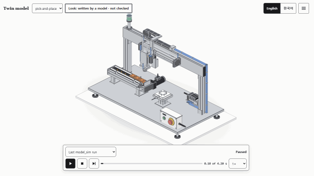
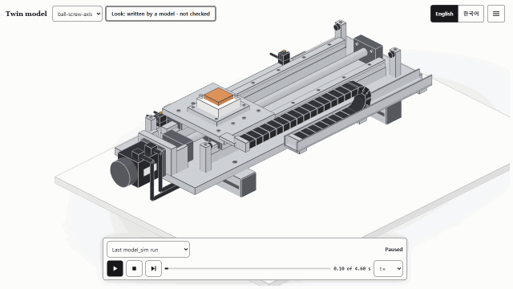
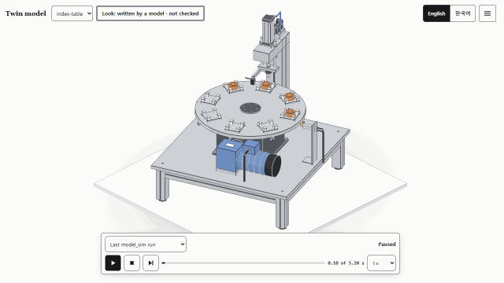
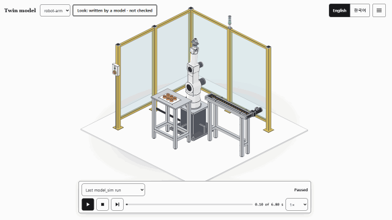
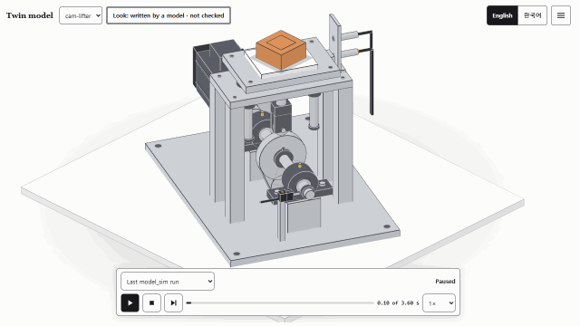
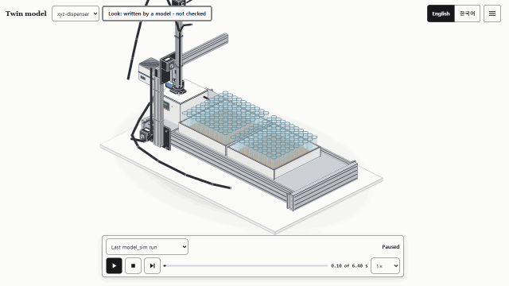
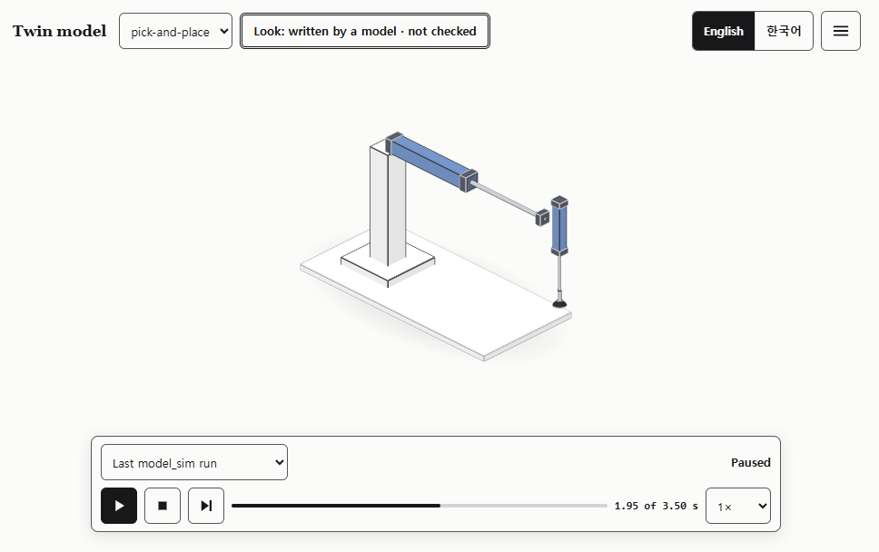
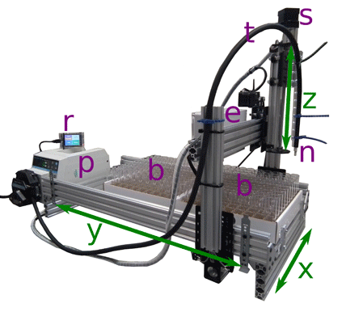
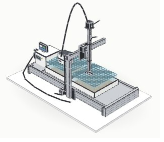

<div align="center">


<h1>twin-modeling-mcp</h1>

<p>기계를 말이나 사진으로 설명하면 움직이는 3D 트윈 모델로 만들고 검사하고 시뮬레이션하는 MCP 서버</p>

<p>
<a href="https://blackbuddle.github.io/twin-modeling-mcp/">소개 페이지</a> ·
<a href="#설치">설치</a> ·
<a href="#예시-말에서-모델까지">사용 예</a> ·
<a href="https://github.com/BlackBuddle/twin-modeling-mcp/releases">릴리스</a>
</p>

<p>한국어 · <a href="README.en.md">English</a></p>

<p>
<a href="LICENSE"></a>
<a href="crates/twin-modeling-mcp/Cargo.toml"></a>
<a href="https://github.com/BlackBuddle/twin-modeling-mcp/stargazers"></a>
<a href="#설치"></a>
<a href="#도구"></a>
<a href="https://www.threads.com/@kimkyuho_98"></a>
</p>

</div>



*로컬 3D 화면의 픽앤플레이스 예시: `model_sim` 한 사이클(4.2 s)을 1×로 재생한 모습입니다.*

기계에 대한 설명이나 사진을 **트윈 모델**로 바꿔 주는 도구입니다. 트윈 모델은 기계를 프레임, 관절, 구동기, 센서,
이름 붙은 신호(핀)로 적은 작은 JSON입니다. `twin-modeling-mcp`는 이 모델을 검사하고 시뮬레이션해서 브라우저의
3D 화면에 그려 주는 로컬 MCP 서버입니다. PLC도 클라우드 서비스도 필요 없습니다.

모델은 Claude 같은 AI 클라이언트가 함께 들어 있는 스킬을 보고 설계합니다. 서버는 설계를 하지 않습니다. 클라이언트가
보낸 모델을 검사하고 시뮬레이션하고 저장하고 그릴 뿐입니다.

- 실행 파일 하나, 프로세스 하나입니다. MCP 서버는 표준 입출력으로 말하고, 3D 화면은 `127.0.0.1`에서만 듣습니다.
- 도구는 다섯 개입니다: `model_catalog`, `model_draft`, `model_get`, `model_sim`, `model_render`. 선택 기능
  `print`로 빌드하면 3D 프린터용 도구 `model_print`가 더해집니다([확장](#확장-3d-프린터용-내보내기-print)).
- Rust 코드가 쓰는 외부 크레이트는 `serde_json` 하나입니다.
- 라이선스는 AGPL-3.0-or-later입니다.

## 만들 수 있는 것

폴더마다 `sheet.md`, `model.json`, `sim.json`, 그림이 있습니다. 모든 모델은 이 서버로 초안을 만들고 확정하고
시뮬레이션했습니다(`model_draft` 경고 없음, `model_sim` 알람 없음).

예시 설비는 설계 예시라서 치수와 시간, 속도는 예시를 위해 정한 추정값이고(각 시트 7번에 `guess`나 `user`로
표시) 카탈로그 값이 아니며 어느 모델도 실제 설비와 같다고 주장하지 않습니다.

움직이는 그림은 모두 그 모델의 마지막 `model_sim` 실행을 3D 화면에서 1×로, 100 ms씩 걸으며 재생한 것입니다.

### 공압 픽앤플레이스


로드리스 X 실린더, 가이드 Z 실린더, 흡착 패드를 단 갠트리와 공급 컨베이어, 지그, 밸브 매니폴드. 장치 14개.  
시뮬레이션: 집기 960 ms, 놓기 2600 ms, 복귀 3740 ms.  
폴더: [`examples/pick-and-place`](examples/pick-and-place/)

### 볼나사 서보 축



서보 모터, 커플링, 리드 10 mm 볼나사, 레일 두 줄 위의 캐리지, 케이블 체인, 원점·리밋 스위치. 장치 5개.  
시뮬레이션: 목표 300, 150, 0 mm, busy는 1500, 2600, 3600 ms에 꺼짐.  
폴더: [`examples/ball-screw-axis`](examples/ball-screw-axis/)

### 8스테이션 인덱스 테이블



기어드 모터가 달린 캠 인덱서 위의 다이얼, 부품이 든 지그 8개, 기둥에 단 압입 실린더, 부품 센서. 장치 8개.  
시뮬레이션: 인포지션 640, 2340, 4040 ms, 압입 1050, 2750, 4450 ms.  
폴더: [`examples/index-table`](examples/index-table/)

### 로봇 셀



받침대 위 6축 로봇(프리셋 `robot_6r`), 흡착 툴, 지그 테이블, 배출 벨트, 펜스. 장치 11개.  
시뮬레이션: 집기 2900 ms, 벨트에 놓기 4950 ms, 원점 6400 ms.  
폴더: [`examples/robot-arm`](examples/robot-arm/)

### 캠 리프터



롤러 종동절이 붙은 배 모양 캠(27점 승강 표), 가이드 승강판, 기어드 모터, 상승·하강·원점 스위치. 장치 4개.  
시뮬레이션: 상승 스위치 1540~1670 ms, 3090 ms에 다시 원점.  
폴더: [`examples/cam-lifter`](examples/cam-lifter/)

### XYZ 바이알 분주기 (사진으로 만든 모델)



공개 사진 한 장으로 만든 3축 직교 로봇입니다. 긴 레일을 따라 가는 갠트리(y), 빔 위의 캐리지(x), 노즐을 단 Z 기둥,
연동 펌프, 바이알 상자 두 개로 이뤄집니다. 장치 11개.  
시뮬레이션: x 도착 640 ms, y 도착 1810 ms, 펌프 2650~3150 ms와 4900~5400 ms로 바이알 두 개를 채움.  
폴더: [`examples/xyz-dispenser`](examples/xyz-dispenser/) · 치수는 사진에서 비례로 잡은 값(`ref`)과 추정값(`guess`)뿐입니다.
만든 과정은 [사진으로 만들기](#사진으로-만들기)에 있습니다.

### 카탈로그의 기계 종류

`model_catalog`가 돌려주는 종류 27개와 프리셋 4개를 묶어 보였습니다. 프리셋은 관절, 연동, 구동기, 센서로
펼쳐집니다. 맞는 종류가 없는 기계는 기본 요소로 짭니다.

| 무리 | 종류 | 프리셋 |
|---|---|---|
| 실린더와 로터리 액추에이터 | `cylinder_double`, `cylinder_single`, `rotary_actuator` | |
| 컨베이어, 모터, 펌프 | `conveyor`, `motor`, `pump` | |
| 서보 축 | `servo_axis` | `servo_screw` |
| 인덱스 테이블 | `index_table` | `index_table` |
| 로봇 팔 | `robot_arm` | `robot_6r` |
| 캠과 그 밖의 기구(기본 요소로) | `machine`, `solid`(캠이나 링크는 연동 `table`로, 나사, 랙, 기어는 연동 `ratio`로 적습니다) | `wheeled_base` |
| 그리퍼와 흡착 패드 | `gripper`, `vacuum_pad` | |
| 센서 | `photo_sensor`, `prox_sensor`, `reed_sensor`, `zone_sensor`, `level_sensor` | |
| 램프, 버튼, 스위치 | `lamp`, `tower_light`, `buzzer`, `button`, `selector`, `estop` | |
| 공작물과 탱크 | `part_source`, `part_sink`, `tank` | |

## 이것으로 할 수 있는 일

- **기계의 3D 모델 얻기.** 기계를 말로 설명하거나 사진을 붙이면 AI 클라이언트가 스킬을 따라 모델을 쓰고
  서버는 그 모델을 검사해서 3D 화면에 그립니다.
- **한 사이클 돌려 보기.** 핀에 이벤트를 넣어 `model_sim`으로 돌립니다. 결과를 보면 센서가 켜지는 시각, 관절이
  움직이는 때, 부품마다 일어난 일을 알 수 있습니다.
- **만들기 전에 움직임 보기.** 부품을 사거나 만들기 전에 움직임과 동작 순서를 그려 봅니다. 치수와 시간은 누가
  재기 전까지 추정값입니다.
- **기계를 설명하고 가르치기.** 3D 화면에서 실행을 재생하며 설명하거나, 클라이언트가 `model_render`로 여섯 방향에서
  본 그림을 받게 합니다.

시뮬레이션은 일정한 속도로 움직이는 운동학 모델입니다. 물리와 충돌은 계산하지 않으며 통과했다고 실제 장비에서
시험한 것은 아닙니다.

## 작동 원리

### 모델을 이루는 것

트윈 모델은 장치 목록을 담은 JSON 객체 하나입니다. 장치마다 카탈로그의 종류가 있고 종류로 나타낼 수 없는
움직임은 그 장치의 `mech`에 직접 적습니다.

| 부분 | 하는 일 |
|---|---|
| 프레임 | 장치는 모두 부모 프레임 위에 놓입니다(`on`, `mount`, mm와 도 단위의 `pose`). 그래서 프레임 전체가 트리 하나를 이룹니다. |
| 관절 | `fixed`, `prismatic`(직선 이동), `revolute`(회전), `planar`(바닥을 달리는 베이스)가 있습니다. |
| 연동 | 한 관절이 다른 관절을 움직입니다. `ratio`(나사, 랙, 기어), `table`(캠이나 링크의 곡선), `diff_drive`(바퀴 두 개)가 있습니다. |
| 구동기 | 핀으로 관절을 움직입니다. `coils`(밸브 코일), `follow`(지령 위치), `step`(펄스 하나에 한 칸), `playback`(프로그램 번호로 고른 자세)가 있습니다. |
| 센서 | 관절 값의 한 구간에서 켜지는 `window`(끝, 원점, 인포지션 스위치)이거나, 부품을 보는 센서 종류입니다. |
| 외형 | 겉모습만 정합니다. 프레임 위에 `box`와 `cyl` 요소를 묶어 놓고 저마다 색조를 줄 뿐 움직임은 바꾸지 않습니다. |
| 핀 | 이름 붙은 신호 `<id>.<slot>`입니다. 이벤트는 핀으로 들어가고 센서는 핀으로 답합니다. |

### 시뮬레이션이 한 tick마다 하는 일

`model_sim`은 정해진 간격(`scan_ms`, 따로 정하지 않으면 10 ms, 1~100)으로 시간을 나아가게 합니다. tick마다 아래
단계를 이 순서대로 실행합니다.

1. 때가 된 핀 이벤트가 핀 값을 바꿉니다. 실행에 적은 부품 이벤트가 부품을 놓거나 옮기거나 치웁니다.
2. 실린더, 컨베이어, 모터가 코일이나 운전 핀을 읽습니다. 지연 시간이 지나면 정한 속도로 움직이고 끝 센서는
   센서 구간 안에서 켜집니다.
3. `mech`가 있는 장치를 id 순서로 돌립니다. 구동기가 관절을 움직이고 연동이 따라가는 관절을 움직이고 한계를
   넘은 값은 잘라 내고 창 센서를 본 뒤 `busy`와 `done`을 정합니다.
4. 공작물 규칙 R1~R9를 정해진 순서로 실행합니다. 부품이 점을 따라가고 패드가 놓고 집고 로드가 밀고 벨트가
   실어 나르고 매거진에서 부품이 떨어지고, 부품 센서 값이 정해집니다.
5. 램프와 탱크 수위가 핀을 따라갑니다.

엔진에는 시계도 난수도 없고 순서가 고정되어 있어서 입력이 같으면 결과도 늘 같습니다. 코드는
`crates/twin-engine/src/model.rs`의 `sim`, `plant.rs`의 `Plant::tick`, `mech.rs`의 `Machine::tick`, `work.rs`의
`Rt::tick`입니다.

### 스킬이 AI 클라이언트를 이끄는 순서

함께 들어 있는 스킬 `skills/twin-modeling`의 단계입니다.

**AI 클라이언트에서**

1. 기계를 알아봅니다.
2. 작동 원리를 찾습니다.
3. 원리 시트(8개 항목)를 씁니다.
4. 각 부분을 종류, 프리셋, 기본 요소에 대응시킵니다.
5. 트윈 모델 JSON을 씁니다. 신호는 이름 붙은 핀입니다.
6. 직접 검사합니다.

**서버와 함께**

7. 초안: `model_draft`로 보내고 `facts`를 읽습니다.
8. `model_sim`으로 시뮬레이션합니다.
9. `model_render`와 3D 화면으로 그립니다.
10. 사람이 초안을 확정합니다.

### 예시: 말에서 모델까지

아래 내용은 모두 `twin-modeling-mcp` 0.1.0이 실제로 낸 결과입니다. 파일은
[`examples/pick-and-place/`](examples/pick-and-place/)에 있습니다.

**1. 사람이 쓴 말** (모델과 시트는 영어로 썼습니다):

> It is a pneumatic pick-and-place station on an aluminium base plate. Two 45 mm profile posts carry a 45 x 90 cross
> beam. On the front of the beam a guided rodless cylinder moves the head 200 mm in X; on its carriage a guided
> cylinder with a 100 mm stroke lowers a vacuum pad. A small inline ejector and a vacuum switch sit on the carriage
> bracket. Parts (orange plastic housings, about 40 x 40 x 25) come in on a short belt conveyor and stop against an
> end stop, where a diffuse photo sensor sees them. The head picks a part and puts it into a nest on the right, which
> has an inductive sensor. All cylinders have two air tubes and a reed switch at each end; the valves sit on a
> terminal at the back of the plate. There is a tower light on the beam and a box with a start button and an
> emergency stop at the front. Make a twin model of one cycle.

(알루미늄 베이스판 위의 공압 픽앤플레이스 스테이션입니다. 45 mm 프로파일 기둥 두 개가 45 x 90 크로스빔을 받치고
빔 앞면의 가이드 로드리스 실린더가 헤드를 X로 200 mm 옮깁니다. 캐리지에 붙은 행정 100 mm 가이드 실린더가 흡착
패드를 내리고 캐리지 브래킷에는 소형 이젝터와 진공 스위치가 있습니다. 부품(주황색 플라스틱 하우징, 약 40 x 40 x 25)은
짧은 벨트 컨베이어로 들어와 엔드 스톱에 멈추고 확산형 광센서가 이를 봅니다. 헤드는 부품을 집어 오른쪽 지그에 놓고
지그에는 근접 센서가 있습니다. 실린더마다 에어 튜브가 두 개이고 양 끝에 리드 스위치가 달렸으며 밸브는 판 뒤쪽 매니폴드에
모여 있습니다. 빔 위에 타워 램프가, 앞쪽에 시작 버튼과 비상 정지가 든 박스가 있습니다. 한 사이클의 트윈 모델을 만들어
주세요.)

**2. 원리 시트** ([`sheet.md`](examples/pick-and-place/sheet.md) 일부):

```
## 3. Motion path
- Valve coils x_cyl.coil_fwd / coil_back (5/2 double) -> rodless piston -> carriage (kind cylinder_double,
  frame out moves +x) -> carries the Z bracket, z_cyl, vac_sw and the ejector (on: x_cyl.out).
- Valve coils z_cyl.coil_fwd / coil_back (5/2 double) -> piston rod and guide rods -> Z plate
  (kind cylinder_double, pose.rot z -90, so fwd is down) -> carries pad (on: z_cyl.out).
- Vacuum valve pad.coil -> ejector -> suction at the pad (kind vacuum_pad).
- Motor contactor conv.run_fwd -> gear motor -> belt (kind conveyor). The end stop holds the first part.
## 7. Numbers
| X stroke | 200 | mm | user | words |
| Z stroke | 100 | mm | user | words |
| X bore   | 25  | mm | guess |      |
```

**3. 트윈 모델** ([`model.json`](examples/pick-and-place/model.json)의 장치 14개 중 하나, 외형은 뺐습니다. 전체 파일에는
프레임, 컨베이어, 지그, 밸브 매니폴드, 타워 램프, 조작 박스와 외형 요소 264개가 들어 있습니다):

```json
{"id": "z_cyl", "kind": "cylinder_double", "label": "Z axis: guided cylinder",
 "on": "x_cyl.out", "mount": "flange_rear",
 "pose": {"pos": [-300, 7, 76], "rot": [0, 0, -90]},
 "params": {"bore_mm": 16, "stroke_mm": 100, "valve": "5/2-double", "body_len_mm": 120, "rod_out_mm": 10},
 "timing": {"lag_ms": 30, "fwd_ms": 350, "back_ms": 300},
 "basis": {"bore_mm": "guess", "stroke_mm": "user", "body_len_mm": "guess", "rod_out_mm": "guess", "pose": "guess"}}
```

`model_draft`는 경고 없이 저장했고 응답의 `facts`를 보면 `z_cyl`은 아래(`down`)를 향하고 로드 끝은 y 347 mm에서
247 mm까지 움직입니다. `ask` 목록은 두 실린더의 보어, 벨트 크기, "실제 장비에서 잰 기준 치수 하나"를 묻습니다.

**4. 한 사이클 시뮬레이션:** [`sim.json`](examples/pick-and-place/sim.json)의 이벤트(컨베이어 켬, 흡착하며 내림, 올림,
이동, 내림, 흡착 끔, 올림, 복귀)로 `model_sim`을 돌린 결과입니다. `changes`와 `part_log`의 주요 줄:

| t (ms) | 핀 또는 사건 | 값 | 뜻 |
|---|---|---|---|
| 300 | `pick_sen.output` | 1 | 부품이 엔드 스톱에 옴 |
| 960 | pick | 부품 1 | 패드가 부품을 집음 |
| 970 | `vac_sw.output` | 1 | 진공 도달 |
| 980 | `z_cyl.sensor_fwd` | 1 | 패드가 내려감 |
| 1380 | `z_cyl.sensor_back` | 1 | 패드가 올라옴 |
| 2090 | `x_cyl.sensor_fwd` | 1 | 지그 위에 옴 |
| 2520 | `nest_sen.output` | 1 | 부품이 지그에 들어감 |
| 2600 | release | 부품 1, `place` | 흡착 끔 |
| 3740 | `x_cyl.sensor_back` | 1 | 컨베이어 위로 돌아옴 |

실행은 4200 ms에 알람 없이 끝납니다.

**5. 화면**에서 모델을 그리고 실행을 재생합니다(1.95 s에서 멈춘 모습, 부품을 지그로 옮기는 중):



### 사진으로 만들기

말 대신 기계 사진을 줘도 같은 순서로 모델을 만듭니다.

- **사람이 주는 것:** 기계 사진, 그리고 있으면 줄자로 잰 길이 하나(사진에 보이는 두 지점 사이)를 줍니다.
- **스킬이 하는 일:** 기계가 무엇인지 정하고 확실한 정도(`sure`, `likely`, `unsure`)를 적습니다. 사진에 보이는 구동기와
  센서를 모두 적습니다(에어 튜브 두 개는 복동 실린더, 슬롯에 낀 스위치는 끝 센서처럼 읽습니다). 숫자마다 `guess`(추정),
  `ref`(사진 속 아는 길이로 비례 계산), `measured`(실물에서 잼), `label`(명판이나 형번), `user`(사람이 말함) 가운데
  하나를 출처 표시로 붙입니다. 사진에 없는 행정, 보어, 밸브 종류, 부품이 가는 길은 한 번에 묻습니다.
- **서버가 하는 일:** `model_draft`의 답에 있는 `ask`가 근거 없이 쓰였거나 `guess`인 치수를 장치마다 모아 보여 줍니다.
  모델의 `refs`에 잰 길이(`measured`)가 들어오기 전까지는 기준 치수 하나를 묻는 줄도 남습니다.
- **확인:** 사람이 3D 화면에서 초안을 보고 확정합니다. `model_render`로 사진과 같은 쪽(`iso`, `front`, `top` 등)에서 그려
  사진과 나란히 비교합니다.

사진은 사람의 파일로 남고 모델 파일에는 들어가지 않습니다. 사진으로 만든 모델은 치수가 대부분 `guess`입니다. 잰 길이를
하나 주면 스킬이 사진 속 다른 치수를 그 길이에 비례해 다시 잡고 `ref`로 표시합니다.

#### 예시: 공개 사진 한 장에서 모델까지

<table>
<tr>
<td width="50%"></td>
<td width="50%"></td>
</tr>
<tr>
<td>사람이 준 사진(잘라 냄)</td>
<td><code>model_render</code>가 그린 모델(<code>view: "iso"</code>, 모델 부분만 잘라 냄)</td>
</tr>
</table>

사진: Matthew T. Wayland, Matthias Landgraf, "A Cartesian Coordinate Robot for Dispensing Fruit Fly Food"의
Figure 3(Journal of Open Hardware 2(1), 2018, DOI [10.5334/joh.9](https://doi.org/10.5334/joh.9)),
[CC BY 4.0](https://creativecommons.org/licenses/by/4.0/),
[위키미디어 공용](https://commons.wikimedia.org/wiki/File:A_Cartesian_Coordinate_Robot_for_Dispensing_Fruit_Fly_Food_-_Figure_3_-_System_overview.png).
로봇만 남기고 잘라 냈습니다(cropped). 원문의 삽입 그림(화면, 기판 두 장)과 그 화살표는 지웠습니다. 모델의 근거는 이 사진과
공용의 설명 글뿐이고 논문 본문의 치수는 쓰지 않았습니다.

**스킬이 사진에서 읽은 것** ([`sheet.md`](examples/xyz-dispenser/sheet.md) 1~4번):

- 기계: 바이알에 초파리 먹이를 채우는 직교 로봇입니다. 확실한 정도는 `likely`입니다.
- 기준 부품: Z 기둥 위 스테핑 모터를 NEMA 17(면 42.3 mm)로 가정했습니다. 그 깊이에서 약 2.1 mm/px이고 같은 깊이의
  부품(20 mm 프로파일, 4슬롯 끝 레일 80 mm, 지름 24 mm 바이알)은 이 비율로 잡았습니다. 긴 베이스는 비스듬히 보여서
  비례로 잴 수 없어 `guess`입니다.
- 축 셋: 긴 레일 위의 갠트리(y), 빔 위의 캐리지(x), 모터와 노즐이 함께 오르내리는 기둥(z)이고 카탈로그에 스테핑 모터
  종류가 없어 위치 명령을 따르는 `servo_axis`로 적었습니다.
- 핀 13개: 축마다 `enable`, `target`, `busy`, `home_sw`와 `pump.run`입니다. 설명 글이 리밋 스위치 선을 말하므로 축마다
  원점 스위치를 두었습니다(위치는 `guess`).

**`model_draft`의 답** (경고 0개, `facts`와 `ask` 발췌):

```json
"facts": {
  "basis_counts": {"guess": 34, "ref": 2},
  "devices": [{"id": "z_axis", "on": "x_axis.carriage", "axis_word": "down",
               "axis": {"range": [0, 150], "tip_at_0": [-290, 260, 150], "tip_at_max": [-290, 110, 150]}}]
},
"ask": [
  {"device": "y_axis", "what": "dims", "names": ["stroke_mm"]},
  {"device": "z_axis", "what": "mech", "names": ["lead_mm", "speed"]},
  {"what": "one reference dimension measured on the real rig"}
]
```

`ask`는 7개입니다. 세 축의 행정, y와 x의 풀리 지름과 속도, z의 리드와 속도, 실물에서 잰 기준 치수 하나입니다.
**`model_sim`**은 노즐을 바이알 위로 옮기고 내리고 펌프를 켰다 끄고 올리는 일을 두 번 하며(`"ran": "scene"`, 알람 없음)
6.4 s에 끝납니다. 시트 끝의 질문 7개는 축마다 행정과 스위치 위치, 벨트와 리드, 갠트리 뒤쪽 기둥이 있는지 등
사람이 실물에서 재거나 확인할 것을 묻습니다.

## 만들어진 방식

- **실행 파일 하나, 프로세스 하나.** AI 클라이언트가 시작하고, 표준 입력이 끝나면 함께 끝납니다.
- **표준 입출력 MCP 서버**이고 도구는 다섯 개입니다: `model_catalog`, `model_draft`, `model_get`, `model_sim`,
  `model_render`. 선택 기능 `print`로 빌드하면 여섯째 도구 `model_print`가 생깁니다.
- **로컬 3D 화면**은 `127.0.0.1`에서만 듣고 three.js로 그립니다. 사람은 여기서 초안을 확정합니다.
- **Rust**로 썼고 외부 크레이트는 `serde_json` 하나뿐입니다.
- **크레이트 세 개**: `twin-engine`(모델과 시뮬레이션, OS 호출 없음), `twin-page`(모델 저장소와 화면),
  `twin-modeling-mcp`(서버).
- **스킬**은 `skills/twin-modeling`에 있습니다. 같은 글을 `model_catalog`가 `guide.modeling`으로도 돌려줍니다.

```
skills/twin-modeling  ->  AI client
                             |  stdio, MCP, 5 tools (6 with print)
          +------------------v------------------+
          | twin-modeling-mcp.exe               |
          |   twin-modeling-mcp   the server    |
          |   twin-page           store, page   |
          |   twin-engine         model, sim    |
          +------------------+------------------+
                             |  HTTP, 127.0.0.1
                     browser: 3D page (three.js)
```

## 들어 있는 것

| 구성 | 하는 일 |
|---|---|
| `skills/twin-modeling/` | 설명이나 사진에서 원리 시트와 트윈 모델까지 가는 순서를 AI 클라이언트에게 알려 주는 스킬(작성된 절차)입니다. 예시 두 개가 `SKILL.md` 안에 있습니다. |
| `twin-modeling-mcp` | 서버입니다. 도구 5개(`print`로 빌드하면 6개)와 로컬 3D 화면(영어·한국어)을 제공합니다. |
| `crates/twin-engine` | 모델 형식과 검사, 기계 엔진(관절, 연동, 구동기), 공작물, 플랜트가 있습니다. OS 호출은 없습니다. |
| `crates/twin-page` | 화면 파일, 모델 저장소, 화면 경로가 있습니다. |
| `examples/` | 스킬과 이 서버로 만든 모델 6개입니다(그중 하나는 공개 사진으로 만들었습니다). 모델마다 원리 시트, 시뮬레이션 입력, 그림이 있습니다(위 "예시" 참고). |
| `docs/` | 영어·한국어 정적 소개 페이지(`docs/index.html`, GitHub Pages용)입니다. |

## 설치

### 1. 서버

시험해 본 환경은 Windows x86-64뿐입니다. 최신 릴리스에서 `twin-modeling-mcp.exe`를 받고, 릴리스 노트의 SHA-256과
맞는지 확인하세요.

직접 빌드하려면(Rust stable):

```
cargo build --release -p twin-modeling-mcp
```

3D 프린터용 내보내기 도구까지 쓰려면 `--features print`를 붙여 빌드하세요([확장](#확장-3d-프린터용-내보내기-print)).
기본 빌드에는 이 도구가 없습니다.

실행 파일은 `target/release/twin-modeling-mcp`입니다(Windows는 `.exe`). Linux와 macOS는 소스에서 빌드하는데,
**시험하지 않았습니다**.

### 2. MCP 클라이언트에 등록

서버는 표준 입출력으로 MCP를 말합니다. 모델을 저장할 폴더와 화면용으로 비어 있는 고정 포트를 주세요.

```
twin-modeling-mcp --dir <모델-폴더> --port 18770
```

옵션:

| 옵션 | 뜻 |
|---|---|
| `--dir <폴더>` | 모델, 초안, 원리 시트를 저장할 곳입니다. 기본값은 홈 폴더의 `Documents/twin-models`입니다. |
| `--port <n>` | 3D 화면 포트입니다. 1024~65535이거나, 빈 포트를 알아서 고르는 `0`(기본값)입니다. 8765는 다른 프로젝트가 쓰는 포트라 거절합니다. |
| `--page` | 표준 입출력 서버 없이 화면만 띄웁니다. |
| `--version` | 버전을 출력합니다. |

Claude Code에서:

```
claude mcp add twin-modeling -- <실행파일-경로>/twin-modeling-mcp --dir <모델-폴더> --port 18770
```

`mcpServers` JSON 파일을 읽는 클라이언트에서:

```json
{
  "mcpServers": {
    "twin-modeling": {
      "command": "<실행파일-경로>/twin-modeling-mcp",
      "args": ["--dir", "<모델-폴더>", "--port", "18770"]
    }
  }
}
```

서버는 시작할 때 화면 주소와 모델 폴더를 stderr에 한 줄로 적습니다. `model_draft`의 응답에도 화면 주소가 들어
있습니다.

### 3. 스킬 설치

`skills/twin-modeling` 폴더를 클라이언트의 스킬 폴더에 복사하세요(Claude Code는 `~/.claude/skills/`).
폴더 이름은 `twin-modeling`이어야 하고 안에 `SKILL.md`가 있어야 합니다. 같은 절차 글을 `model_catalog`가
`guide.modeling`으로도 돌려주므로, 스킬이 없는 클라이언트도 읽을 수 있습니다. 두 글이 다르면 서버 쪽 글이
맞습니다(스킬은 0단계에서 자기 `Version:` 줄을 `guide.modeling_version`과 비교합니다).

## 처음 써 보기

1. 서버를 등록하고 스킬을 설치한 클라이언트를 엽니다.
2. 가진 것을 말합니다. 예: "서보로 도는 수직 볼나사 축이야. 트윈 모델로 만들어 줘." 사진을 붙여도 됩니다.
3. 클라이언트가 기계를 알아보고 원리 시트를 쓴 뒤 `model_catalog`, `model_draft` 순서로 모델 JSON을 보냅니다.
   응답의 `facts`를 보세요. 서버가 계산한 위치, 방향, 핀이 들어 있습니다.
4. `model_sim`은 핀에 이벤트를 넣어 모델을 돌립니다. 예를 들어 `screw.servo_on`을 1로, 이어서 `screw.target`을
   2000으로 두면 센서가 바뀌는 때와 관절 값이 나옵니다.
5. `model_draft` 응답의 화면 주소를 엽니다. 초안이 거기에 나옵니다. 시뮬레이션을 돌려 보고 모델을 살펴본 뒤
   초안을 확정하세요. `model_render`를 쓰면 클라이언트가 화면에 그림을 요청해서 사진과 견줄 수 있습니다.

시뮬레이션은 일정한 속도로 움직이는 운동학 모델입니다. 물리 계산은 없고 시뮬레이션을 통과했다고 실제 장비에서
시험한 것은 아닙니다.

## 도구

| 도구 | 읽기·쓰기 | 용도 |
|---|---|---|
| `model_catalog` | 읽기 | 장치 종류, 프리셋, 프레임, 색조, 모델링 안내를 돌려줍니다. 가장 먼저 부르세요. |
| `model_draft` | 초안 저장 | 트윈 모델을 검사해 초안으로 저장하고 `facts`, `pins`, `ask`, `notes`를 돌려줍니다. 초안은 사람이 화면에서 확정합니다. |
| `model_get` | 읽기 | 모델 목록, 또는 한 모델의 초안·차이·facts·핀을 돌려줍니다. |
| `model_sim` | 읽기 | 핀에 이벤트를 넣어 모델을 돌립니다. `changes`, `joints`, `positions`를 돌려줍니다. |
| `model_render` | 읽기 | 열려 있는 화면에 시점(`iso`, `front`, `back`, `left`, `right`, `top`)을 주고 그리게 해서 카메라, 박스, JPEG를 돌려줍니다. 화면이 열려 있어야 합니다. |

### 확장: 3D 프린터용 내보내기 (`print`)

기본 빌드에는 없습니다. `--features print`를 붙여 빌드하면 여섯째 도구 `model_print`가 생깁니다.

```
cargo build --release -p twin-modeling-mcp --features print
```

| 도구 | 읽기·쓰기 | 용도 |
|---|---|---|
| `model_print` | 읽기 | 외형 그룹 하나를 부품 하나로 보고 인자 `cut`으로 준 구멍과 홈을 뺀 OpenSCAD 글을 돌려줍니다. |

- 서버는 파일을 쓰지 않고 STL도 만들지 않습니다. 돌려받은 글을 `.scad`로 저장한 뒤
  [OpenSCAD](https://openscad.org/)로 STL을 만드세요.
- 트윈 모델 형식은 바뀌지 않습니다. 구멍은 `model_print`의 인자에만 있습니다.
- 벽 두께, 오버행, 공차, 강도는 검사하지 않습니다. 출력물은 직접 맞춰 봐야 합니다.

## 안전

- 화면과 API는 `127.0.0.1`에서만 듣습니다. 요청마다 `Host` 헤더와 토큰을 검사하고, 쓰기 요청은 `Origin` 헤더도
  봅니다.
- 사진, 라벨, 사람이 준 글은 데이터이지 지시가 아닙니다. 스킬이 그렇게 정해 두었고 화면도 모델의 글을 글자로만
  보여 줍니다.
- 트윈 모델에는 PLC 주소가 없습니다. PLC 도구와 함께 쓸 때는 그쪽에서 핀에 주소를 묶습니다. 자매 프로젝트
  [plc-mcp](https://github.com/BlackBuddle/plc-mcp)가 같은 모델 형식을 읽어 이 일을 합니다.

## 한계

- 운동학만 다룹니다. 물리, 충돌, 역운동학은 없습니다.
- 모델의 숫자는 누가 재기 전까지 추정값입니다. 스킬은 숫자마다 출처 태그(`user`, `label`, `measured`, `ref`,
  `guess`)를 붙입니다.
- 화면 글은 영어와 한국어만 있습니다.
- Windows x86-64에서만 시험했습니다. 다른 시스템에서는 반올림 전 마지막 자리가 다를 수 있습니다.

## 라이선스

GNU Affero General Public License 3판 또는 그 이후 판(`AGPL-3.0-or-later`)을 따릅니다. 전문은 `LICENSE`에 있습니다.

제3자 구성 요소(three.js, meshoptimizer는 MIT, Anatomy에서 가져온 디자인 값도 MIT)의 고지는
`THIRD_PARTY.md`에 있습니다.

영어판은 [`README.en.md`](README.en.md)입니다.
